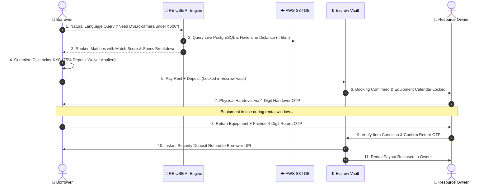
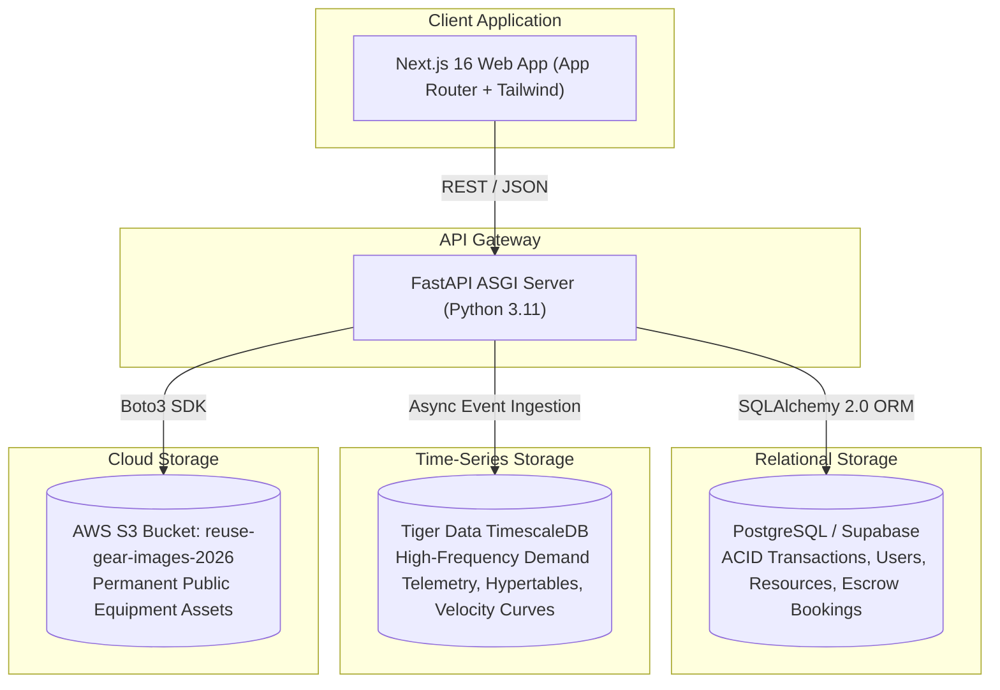

<!-- RE:USE Hyperlocal Resource Sharing & Circular Marketplace (Production Release) -->
# 🌐 RE:USE — Hyperlocal Resource Sharing & Circular Marketplace

<p align="center">
  
</p>

<p align="center">
  <strong>"It’s not a shortage, it’s a matching failure. Don't buy more — share what already exists."</strong>
</p>

<p align="center">
  <a href="https://reuse-backend-cbc3.onrender.com/docs"></a>
  <a href="https://nextjs.org"></a>
  <a href="https://aws.amazon.com/s3/"></a>
  <a href="https://www.timescale.com/"></a>
  <a href="https://groq.com"></a>
  <a href="https://www.postgresql.org/"></a>
</p>

---

## 📌 Live Deployments & Endpoints

| Service | Target URL | Status | Description |
|---|---|---|---|
| **Production Backend API** | [`https://reuse-backend-cbc3.onrender.com`](https://reuse-backend-cbc3.onrender.com) | `🟢 200 OK` | FastAPI ASGI Microservice hosted on Render |
| **Interactive Swagger Docs** | [`https://reuse-backend-cbc3.onrender.com/docs`](https://reuse-backend-cbc3.onrender.com/docs) | `🟢 Live` | Full OpenAPI specification & interactive testing |
| **Cloud Object Storage** | `s3.ap-south-1.amazonaws.com/reuse-gear-images-2026` | `🟢 Live` | Global AWS S3 bucket for verified equipment assets |
| **Telemetry TimescaleDB** | `bufgz7llp5.tiger.timescale.com:30869` | `🟢 Active` | Tiger Cloud TimescaleDB time-series hypertable |
| **GitHub Repository** | [`khaleek696-art/reuseproject`](https://github.com/khaleek696-art/reuseproject) | `🟢 Main` | Continuous integration & deployment tracking |

---

## 💡 The Core Problem RE:USE Solves

Every year, millions of high-value household, maker, and campus items (**DSLR cameras, impact drills, 4K cinema bodies, projectors, camping gear, and laptops**) sit unused in closets over **90% of the time**. Simultaneously, college students, creators, and neighbors spend thousands of rupees buying or renting equipment they only need for a few hours.

Traditional classifieds (like OLX) fail for daily borrowing because of **three fatal friction points**:
1. **Search & Distance Friction:** Keyword searches fail to understand natural language requirements, timing, and walking campus distances.
2. **Theft & Trust Dilemma:** Equipment owners refuse to lend expensive gear to unverified strangers.
3. **Financial & Dispute Risk:** Borrowers fear losing security deposits, while owners have no recourse if items return damaged.

**RE:USE** solves this through a **hyperlocal AI-matched, DigiLocker-verified, escrow-protected circular economy platform**.

---

## 🚀 Key Architectural Pillars & Innovations

### 1. 🤖 AI-Powered Semantic Matching & Geofencing
* **Natural Language Queries:** Borrowers search conversationally (e.g. *"I need a professional DSLR camera near campus this Saturday under ₹600"* or Hinglish *"drill machine chahiye"*).
* **5-Factor Intent Scoring:** Combines semantic keyword extraction, budget constraint parsing, time availability overlap, owner reputation, and geodesic distance via the **Haversine Algorithm** (geofenced to a 2km–5km radius).
* **Honest Fallback State:** If an exact item is unavailable, the engine transparently alerts the user and surfaces top-rated campus alternatives instead of generating deceptive high-confidence matches.

### 2. 🛡️ DigiLocker Citizen KYC & Anti-Theft Verification
* **Government Identity Verification:** Simulates **DigiLocker Citizen KYC** validating **UIDAI Aadhaar**, **Income Tax PAN**, and **Academic ABC Student ID** with 256-bit encryption.
* **Trust-Weighted Deposit Waivers:** Verified citizens boost their PeerTrust score to 5.0★ and unlock a **75% Security Deposit Waiver**, dramatically lowering rental barriers for students while eliminating anonymous rental theft.

### 3. 🔒 100% Trustless Escrow Vault & 4-Digit OTP Handover
* **Zero Direct Cash Transfers:** Rental fees and security deposits are locked inside the **RE:USE Escrow Vault** upon checkout.
* **4-Digit Handover & Return OTP:** Physical custody transfers require a **4-digit Handover OTP**. Returns require a **Return OTP** paired with an in-person item inspection checklist.
* **Instant Automated Refunds:** Once clean return is confirmed, the security deposit is automatically refunded back to the borrower's UPI account, and rental earnings are disbursed to the owner.

### 4. 📈 DemandPulse™ Time-Series Analytics (Tiger Data TimescaleDB)
* High-frequency marketplace events (`search_performed`, `rental_requested`, `rental_completed`) stream asynchronously into a **TimescaleDB hypertable (`marketplace_demand_events`)**.
* Powers a live **24-Hour Rental Velocity Curve** and **Category Shortage Matrix**, alerting idle equipment owners to local deficits (e.g., *20.9x Camera Deficit in Whitefield*) so they can list gear and maximize earnings.

### 5. ☁️ AWS S3 Enterprise Cloud Asset Pipeline
* Equipment images are uploaded via FastAPI `boto3` SDK directly to **AWS S3 (`reuse-gear-images-2026`)** in the `ap-south-1` region.
* Generates permanent, globally accessible public HTTPS URLs, ensuring newly listed equipment renders in real-time across all devices, browsers, and mobile screens.

### 6. 🌱 Quantified Circular Impact & Eco-Gamification
* Measures environmental and economic savings per transaction using EPA WARM metrics (**CO₂ emissions saved, e-waste diverted, and money saved**).

---

## 📊 System Architecture & Data Flow

### 1️⃣ End-to-End Circular Rental Lifecycle



---

### 2️⃣ Dual-Database Architecture



---

## 👥 Role-Based Access Control (RBAC) Matrix

RE:USE provides 4 dedicated, isolated user personas accessible via the instant role switcher:

| Role | Persona | Key Features & Access | Permissions |
|---|---|---|---|
| **Borrower** | Campus Students & Neighbors | Natural language AI search, DigiLocker KYC, Escrow checkout, OTP receipt, return confirmation, PeerTrust reviews | Cannot edit listings or access Admin console |
| **Resource Owner** | Equipment Lenders | Equipment listing modal (AWS S3 photo upload), rate & deposit controls, booking approval, return inspection, payout wallet | Cannot borrow own items or access Admin console |
| **Delivery Courier** | Campus Runners & Cargo Couriers | Hyperlocal dispatch radar (within 4km), accept jobs, 4-digit custody OTP verification, earn delivery fees | Cannot edit listings or arbitrate disputes |
| **Platform Administrator** | Safety & Trust Officers | Dispute arbitration console, escrow manual split/refund, TimescaleDB demand telemetry, trust weight tuning | System supervision & platform governance |

---

## 🛠️ Complete Tech Stack

```
RE:USE System Stack
├── Frontend: Next.js 16 (App Router), TypeScript, Tailwind CSS, Lucide React, Leaflet Maps
├── Backend: Python FastAPI, Uvicorn ASGI Server, Pydantic v2 schemas
├── Database 1: PostgreSQL (Supabase / Render) via SQLAlchemy 2.0 Async ORM
├── Database 2: Tiger Cloud TimescaleDB (Time-series hypertable for demand forecasting)
├── Cloud Storage: AWS S3 Bucket (reuse-gear-images-2026) via Python Boto3 SDK
├── AI Engine: Groq Llama-3.3-70B API + Haversine Geodesic Spatial Matching
├── Trust & KYC: DigiLocker Simulated Citizen Verification (Aadhaar, PAN, ABC ID)
├── Payments & Escrow: Razorpay Escrow Integration with Automated UPI Refunds
└── Hosting: Netlify (Frontend CDN) + Render (FastAPI Microservice & PostgreSQL)
```

---

## 🗂️ Project Directory Structure

```
reuseai/
├── src/
│   ├── app/
│   │   ├── page.tsx               # Landing Page & Circular Economy Hero
│   │   ├── explore/page.tsx       # Hyperlocal Radar & Campus Map Search
│   │   ├── resources/page.tsx     # Equipment Catalog & Live Listings
│   │   ├── matches/page.tsx       # AI Semantic Match Assistant & Specs Analysis
│   │   ├── demandpulse/page.tsx   # TimescaleDB Time-Series Demand Analytics
│   │   ├── bookings/page.tsx      # Active Rentals & 5-Stage Stepper
│   │   ├── deliveries/page.tsx    # Cargo Courier Dispatch Console
│   │   ├── profile/page.tsx       # DigiLocker KYC Hub & Credentials
│   │   ├── admin/page.tsx         # Escrow Arbitration & Admin Controls
│   │   └── api/upload/route.ts    # AWS S3 Cloud Upload Proxy Route
│   ├── components/
│   │   ├── Navbar.tsx             # Role Switcher & Navigation Header
│   │   ├── BookingModal.tsx       # Checkout Modal with Escrow & 75% KYC Waiver
│   │   ├── DigiLockerModal.tsx    # Government KYC Citizen Verification Flow
│   │   ├── AddResourceModal.tsx   # Equipment Listing with AWS S3 Boto3 Upload
│   │   └── ReturnOtpRefundModal.tsx # Return OTP & Instant Escrow Refund Modal
│   └── lib/
│       ├── roleContext.tsx        # Central RBAC, KYC State & Live Catalog Sync
│       ├── api.ts                 # Gateway Client connecting to FastAPI
│       ├── matchEngine.ts         # 5-Factor Weighted Matching Pipeline
│       └── utils.ts               # Haversine Distance & Currency Formatters
└── backend/
    ├── app/
    │   ├── api/
    │   │   ├── auth.py            # Brevo Email OTP & JWT Session Handlers
    │   │   ├── resources.py       # Equipment CRUD & AWS S3 Boto3 Integration
    │   │   ├── matches.py         # Dynamic AI Natural Language Match Endpoint
    │   │   ├── bookings.py        # Custody Progress & 4-Digit OTP Transitions
    │   │   ├── payments.py        # Razorpay Escrow Orders & Instant UPI Refunds
    │   │   └── analytics.py       # DemandPulse Tiger Data TimescaleDB Endpoints
    │   ├── core/
    │   │   ├── database.py        # SQLAlchemy Async PostgreSQL Connection Pool
    │   │   ├── tiger_db.py        # Tiger Cloud TimescaleDB Connection
    │   │   └── storage.py         # AWS S3 Boto3 SDK Upload Handlers
    │   ├── models/                # SQLAlchemy Models (User, Resource, Booking)
    │   └── services/
    │       └── demandpulse.py     # TimescaleDB Event Ingestion & Hypertable Queries
    └── main.py                    # FastAPI ASGI Master Application
```

---

## ⚡ Quick Start & Local Setup

### 1️⃣ Clone Repository
```bash
git clone https://github.com/khaleek696-art/reuseproject.git
cd reuseproject
```

### 2️⃣ Backend Setup (Python FastAPI)
```bash
cd backend
python3 -m venv venv
source venv/bin/activate        # On Windows: venv\Scripts\activate
pip install -r requirements.txt

# Run FastAPI Server
uvicorn app.main:app --reload --port 8000
```
> Interactive API Docs will launch at `http://localhost:8000/docs`.

### 3️⃣ Frontend Setup (Next.js 16)
```bash
# In the project root directory
npm install
npm run dev
```
> Open `http://localhost:3000` in your browser.

---

## 🧪 Production Verification

To verify full TypeScript compilation and static generation across all 18 routes:

```bash
npm run build
```

```
✓ Compiled successfully in 1505ms
✓ Generating static pages using 7 workers (18/18) in 268ms
✓ Zero TypeScript or linting errors
```

---

## 📄 License & Attribution

Crafted for sustainable campus communities and circular economy initiatives. Built with ❤️ for zero single-use waste.
<!-- RE:USE — Modular Circular Economy Architecture -->
